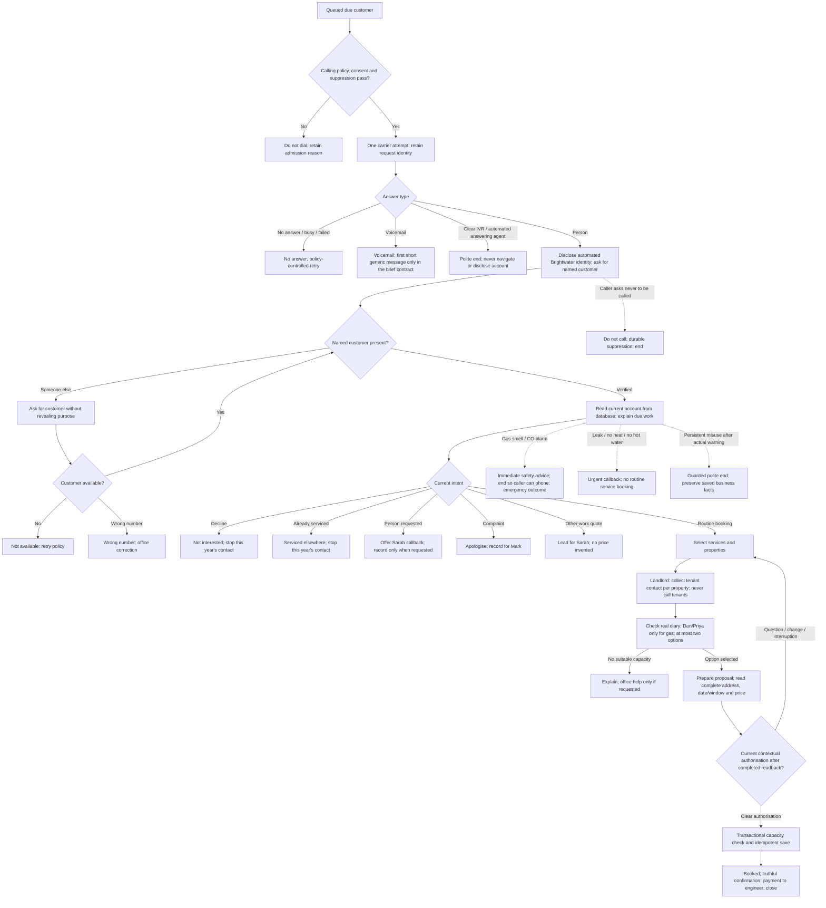

# Agent design and campaign contract

Assessment reference: TMG-TA-2611-01. This document describes the intended assessment behaviour. [Coverage](assessment-coverage.md) distinguishes implemented policy from handset-qualified behaviour; the diagram does not claim every branch has passed a phone test.

## Call flow

Safety/stop requests can occur before identity or at any later stage. They do not require account disclosure. Interrupted, stale or ambiguous speech cannot authorise a booking. Recording refusal stops the recorded interaction. A changed speaker revokes identity. Ordinary complaints, frustrated agreement and genuine questions are not misuse.

The brief requires a first generic voicemail message. The current native engineering candidate ends on voicemail; restoring and qualifying that rule with a real callback number remains outstanding. Actual safety wording is in the loaded prompt and policy module; production approval requires reconciling the brief with independently verified current safety guidance.

## Exact loaded instructions and opening

The source of the native prompt is [`backend/src/brightwater/managed/prompt.txt`](../../backend/src/brightwater/managed/prompt.txt). The opening and native tool schemas are in [`managed/agent.py`](../../backend/src/brightwater/managed/agent.py). Resource IDs and credentials are private; customer details are loaded during the call.

Current opening: “Hi, I'm Alex, Brightwater's AI assistant. This is a recorded engineering test with fictional details. Am I speaking with {{customer_name}}?” The actual native phone profile uses the owner-selected Valory voice. An engineering opening is not a claim that a customer-production campaign is enabled.

## Native business tools

| Tool | Input | Result / authority |
| --- | --- | --- |
| `confirm_identity` | No model-supplied customer name | Current caller verification; account returned only after success |
| `check_availability` | Property IDs and services from this account | At most two valid diary options; no reservation |
| `prepare_booking` | Selected offer and tenant contact per landlord property | Scoped proposal and complete readback facts; not a booking |
| `confirm_booking` | Current proposal ID | Independent current consent/playback/capacity checks, idempotent booking result |
| `cancel_arrangement` | Current proposal ID | Cancels only the identified current arrangement; does not guess a historic appointment |
| `record_followup` | Callback/complaint/urgent/emergency/lead kind | Saves only supported current intent; no live transfer or promised callback time |
| `finish_conversation` | No invented business result | Finalises from saved facts or returns a guarded boundary-recovery instruction |
| Native `end_call` | Native ending reason / farewell | Ends audio after the truthful closing; no business-write authority |

Typed REST contracts are in `backend/src/brightwater/schemas.py` and `managed/agent.py`. Prices are £95 service, £75 CP12, £60 per CP12 property for three or more, and £145 combined, including VAT. Gas work cannot be assigned to Tom.

## Campaign logic

The database/worker select unresolved obligations about four weeks before due, then recheck at dispatch. UK-local hours are Mon–Fri 10:00–19:30, Sat 10:00–13:00, never Sunday. A customer's later preference wins. Up to three attempts are separated by at least a day and use different time bands. Conversation, annual refusal/completion and permanent suppression stop the appropriate future contacts. A fenced Beat scheduler, durable intent and transactional claims prevent duplicate scheduling; uncertain carrier initiation is reviewed rather than automatically redialled.

Original drama-range numbers remain blocked. A separate owned/consented destination must be registered. Automatic UK campaigns remain disabled. The attended UK route has saved a fictional booking. The assessment review uses the separate attended form and the reviewer’s agreed destination. See [attended evidence](test-evidence.md).

## Questions before real customers

1. Who may authorise calls, what permission/retention rules apply, and how will suppression be synchronised with every existing list? Incorrect assumptions can create unwanted calls or data exposure.
2. Which real UK number/callback route may be presented, and who answers it during/after office hours? The supplied fictional number cannot be used operationally.
3. Which diary is authoritative, what travel time/holidays/absences must be blocked, and what is the fallback when a certificate cannot be booked before due? Availability alone is not a staffing commitment.
4. Can a proxy ever authorise work, and what verification is acceptable? The current default requires the named customer.
5. How should failed calls after connection fit the required outcome taxonomy without claiming an unanswered call? The current engineering records preserve that uncertainty.
6. Who signs off emergency wording, complaint handling, accessibility needs and the six scenario recordings? Automated tests are not customer-safety approval.
7. What monthly budget, monitoring/support response and recovery arrangements does Mark require? The present deployment is a candidate, not a qualified enterprise service.
